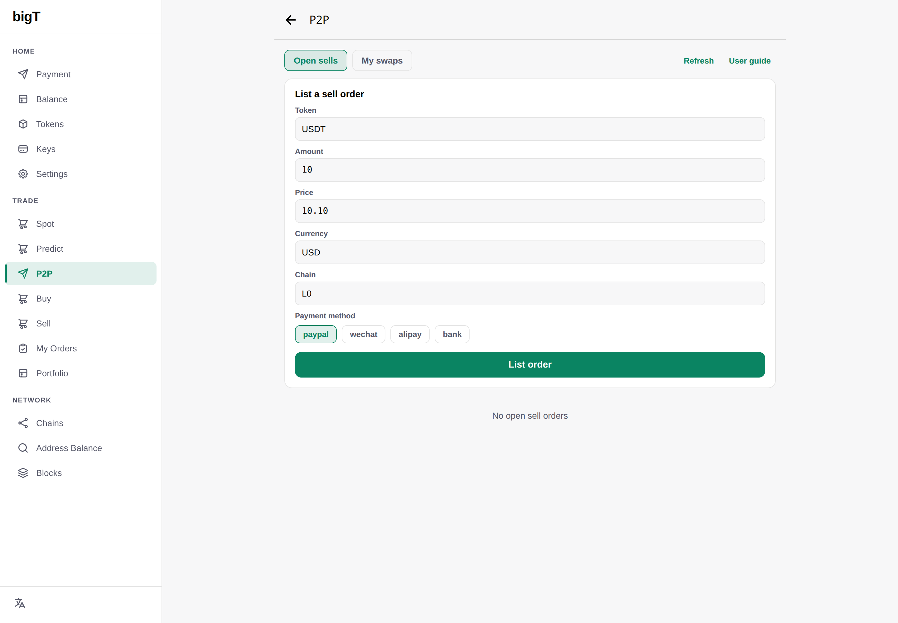
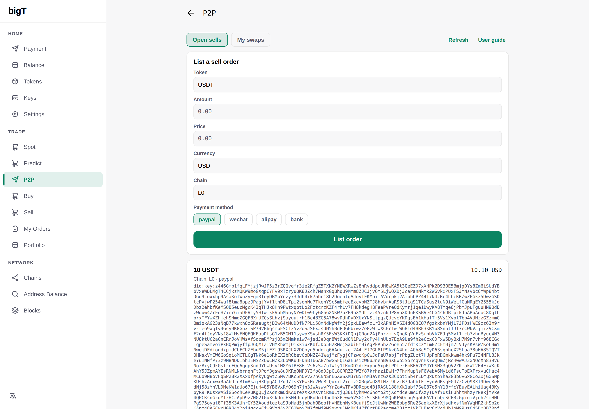
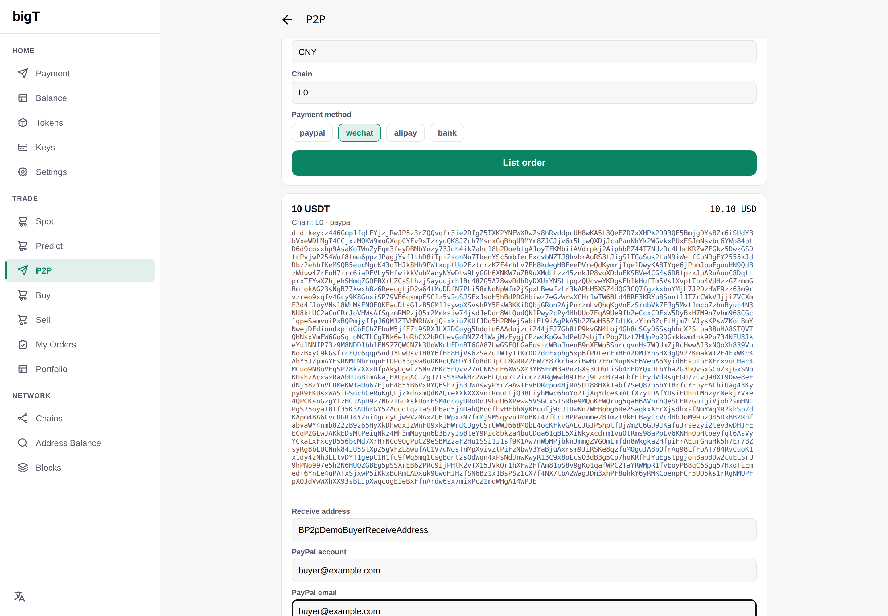
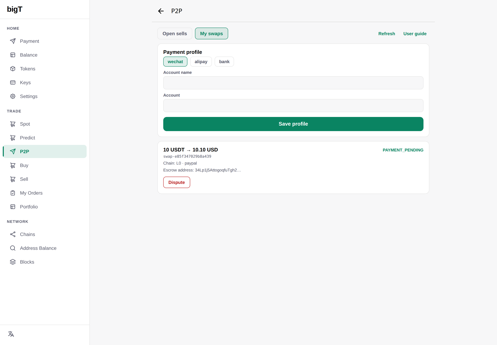
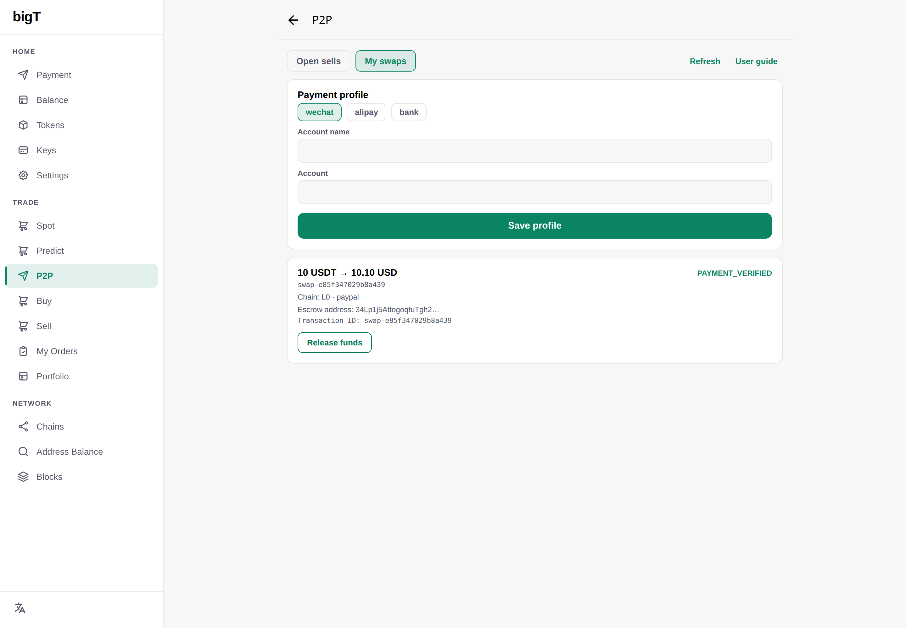
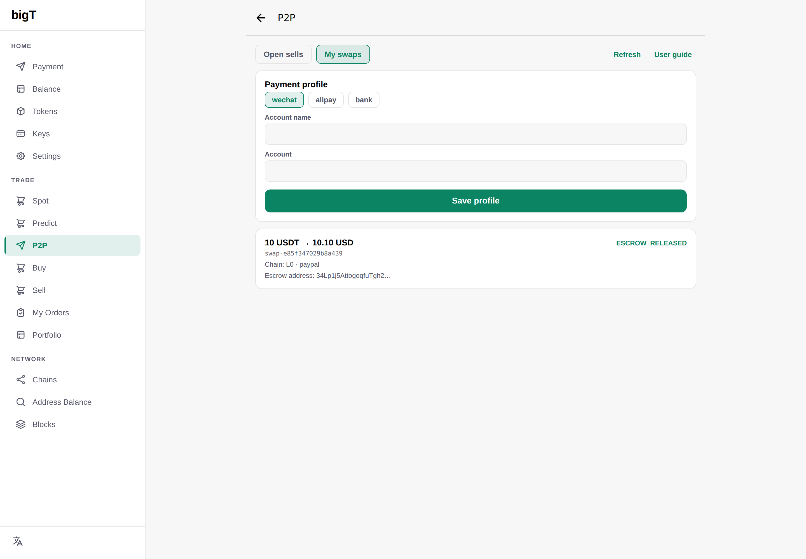
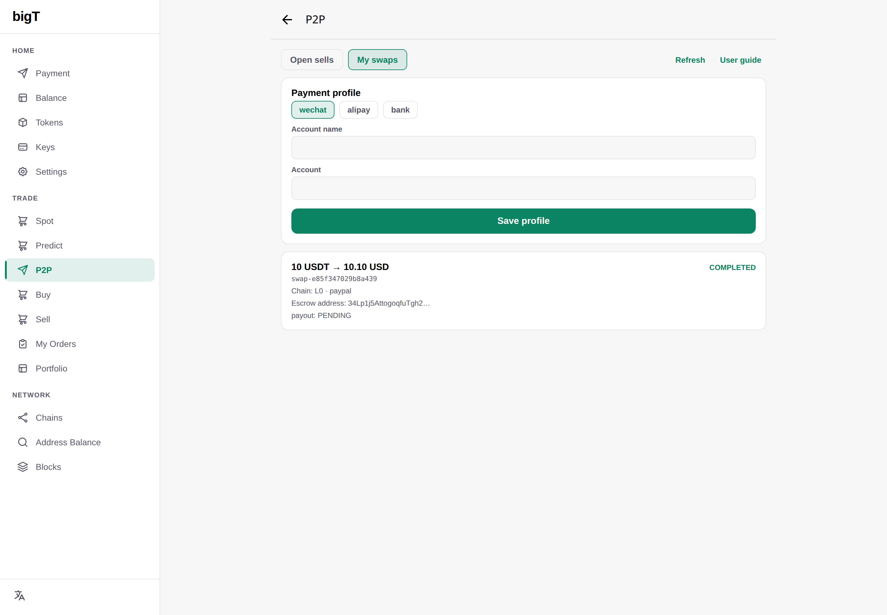

# P2P settlement — all-rails swap demo (PayPal / WeChat / Alipay / Bank)

Status: **built and captured**. Every screenshot below was taken from the real
wallet UI driving the real `p2p-engine` on 2026-10-12 — one engine, no mocks.
The PayPal leg was captured by `e2e/capture-p2p-guide.mjs` (fresh wallet pair,
USD 10.10) and the three CNY legs by `e2e/capture-p2p-cny.mjs` (a fresh wallet
pair per rail). The rail is a data field, not a fork
(`docs/p2p.md` §7): the same 2-of-3 escrow, the same PQ-signed state machine,
four different fiat legs.

Companion documents: [docs/p2p.md](../p2p.md) (design, protocol & threat
model), engine source `services/p2p-engine/src/`.

---

## 0. What this demo proves (read first)

1. **One state machine, four fiat rails.** `wantRail ∈ {paypal, wechat,
   alipay, bank}` decides the whole fiat leg. PayPal keeps
   `payment_send`/`verify`/`payout` (invoice + webhook, no human
   confirmation); the CNY rails use
   `instructions`/`proof`/`confirm`/`release`/`complete`
   (`state.ts:12-24`). Everything before `MATCHED` and the escrow lock is
   identical.
2. **2-of-3 P2SH escrow on Bigtangle L0.** Seller, buyer and engine hold one
   key each; any two satisfy the script. Nobody — including the engine — can
   move the tokens alone. The engine proves the lock on chain and fails closed
   if the transaction is not `CONFIRMED` at the derived escrow address.
3. **PayPal: no seller "Confirm" button.** The buyer pays a hosted,
   exact-amount invoice; the engine verifies the
   `INVOICING.INVOICE.PAID` webhook (RSA-signed, deduplicated) and then
   itself signs `verify`. The payer cannot self-assert payment.
4. **CNY rails: the seller's own confirmation is the fiat signal.** There is
   no webhook for a WeChat/Alipay/bank transfer. `PAYMENT_CLAIMED` is only the
   buyer's claim (流水号 + optional receipt); tokens stay locked until the
   seller signs `confirm` after checking their own account — the UI repeats
   this as a red warning above the *Confirm received* button.
5. **PII never reaches the order book or the chain.** `GET /public/orders`
   carries only the trade terms. The seller's 收款 account (WeChat ID, Alipay
   account, or bank card + bank name) is revealed party-scoped by
   `POST /swaps/:id/payment-instructions`; only a per-swap `remark` code plus
   (optionally) a receipt `sha256` are stored on the swap event.
6. **Every mutating call is signed with the party's PQ (ML-DSA-87) `did:key`**
   — the same wallet key that signs chain transactions — over the sha256 of
   the canonical (sorted top-level keys) JSON body, plus a nonce + timestamp
   (±5 min): replay-protected, rate-limited to 10 signed requests per DID per
   minute (`sign.ts:17-19`). The demo's final legs (`verify`/`release`/
   `payout` on PayPal; `release`/`complete` on CNY) are signed by the engine
   signer (`SETTLEMENT_ENGINE_DID`, an ML-DSA did:key ≈3.5 kB); nothing fires
   them automatically yet, so the capture script stands in for that operator
   job (§6.1).

---

## 1. State machines — who advances each step

**PayPal rail** (webhook-verified, no seller confirmation):

| # | Status | Action (HTTP) | Who must sign | Evidence |
|---|---|---|---|---|
| 1 | `MATCHED` | `POST /orders/:id/match` | buyer | `receiveAddress` + `paypalAccount` (+`buyerEmail`) |
| 2 | `ESCROW_LOCKED` | `POST /swaps/:id/transitions` `action=escrow_lock` | **seller** | `txHash` (escrow lock proof, checked on L0) |
| 3 | `PAYMENT_PENDING` | `POST /swaps/:id/transitions` `action=payment_send` | buyer | hosted invoice paid at PayPal (hint only) |
| 4 | `PAYMENT_VERIFIED` | `POST /swaps/:id/transitions` `action=verify` | **engine** | `INVOICING.INVOICE.PAID` webhook, RSA-verified |
| 5 | `ESCROW_RELEASED` | `POST /swaps/:id/transitions` `action=release` | **engine + buyer** | `txHash` (2-of-3 spend to receiveAddress) |
| 6 | `COMPLETED` | `POST /swaps/:id/transitions` `action=payout` | **engine** | PayPal Payout batch (idempotent on swapId) |

**CNY rails** (`wechat` / `alipay` / `bank` — seller-confirmed):

| # | Status | Action (HTTP) | Who must sign | CNY-specific evidence |
|---|---|---|---|---|
| 1 | `MATCHED` | `POST /orders/:id/match` | buyer | `receiveAddress` (token payout address) |
| 2 | `ESCROW_LOCKED` | `POST /swaps/:id/transitions` `action=escrow_lock` | **seller** | `txHash` (escrow lock proof) |
| 3 | `PAYMENT_PENDING` | `POST /swaps/:id/payment-instructions` | buyer | `remark` (12 hex chars, per-swap) |
| 4 | `PAYMENT_CLAIMED` | `POST /swaps/:id/proof` | buyer | `txId` 流水号, optional `receipt` + `receiptSha256` |
| 5 | `PAYMENT_VERIFIED` | `POST /swaps/:id/confirm` | **seller** | the seller's own statement check |
| 6 | `ESCROW_RELEASED` | `POST /swaps/:id/transitions` `action=release` | **engine** | `txHash` (release proof) |
| 7 | `COMPLETED` | `POST /swaps/:id/transitions` `action=complete` | **engine** | — (seller already holds the CNY) |

Freeze paths on the CNY rails: either party may `POST /swaps/:id/dispute`
while `PAYMENT_PENDING`/`PAYMENT_CLAIMED`; the admin then resolves with
`outcome=release|refund` (`server.ts:765-809`). On PayPal,
`PAYMENT.CAPTURE.REVERSED` sets a freeze and `CUSTOMER.DISPUTE.*` pauses the
swap. `expire`/`refund`/`cancel` stay available before release so a failed
deal can always return the tokens.

---

## 2. The rails and how they are configured

| Rail (`wantRail`) | Buyer pays | Seller verifies | Tokens released by |
|---|---|---|---|
| `paypal` | PayPal invoice (hosted, exact amount) | PayPal webhook → engine `verify` | engine `payout` → `COMPLETED` |
| `wechat` | WeChat Pay to seller's WeChat ID | seller's own 流水 + remark | engine `release` + `complete` |
| `alipay` | Alipay to seller's account | seller's own 流水 + remark | engine `release` + `complete` |
| `bank` | bank transfer + remark | bank statement + remark | engine `release` + `complete` |

Engine environment (`services/p2p-engine/src/server.ts`):

```bash
SETTLEMENT_CNY_RAILS=wechat,alipay,bank  # unset → all three; "" → rail off
SETTLEMENT_CNY_REMARK_TTL=900            # seconds → payBy deadline in instructions
SETTLEMENT_ENGINE_DID=did:key:z446Gmp1… # ML-DSA-87 did:key (≈3.5 kB); only signer of release/complete/verify
SETTLEMENT_ENGINE_PUBKEY=050101010a20…  # prefixed ML-DSA pub (hex) → 2-of-3 escrow address derivation
SETTLEMENT_STORE=mem|pg                  # mem for demos, pg for production
SETTLEMENT_ADMIN_TOKEN=adm               # /orders, /swaps, dispute/resolve
SETTLEMENT_PAYPAL_INSECURE=1             # demo only: skip real PayPal API calls
CORS_ORIGIN=http://localhost:18081       # wallet web app origin
```

---

## 3. Running the demo yourself

```bash
# 1. workspace packages the engine imports
for pkg in chain-discovery did p2p-protocol record-sig; do ( cd packages/$pkg && npm run build ); done

# 2. engine bundle (esbuild → dist/server.bundle.mjs)
( cd services/p2p-engine && npm run build && npm run bundle )

# 3. wallet web app with the engine URL inlined by `expo export`
( cd expo-app && EXPO_PUBLIC_P2P_ENGINE_URL=http://localhost:18089 npm run web:build )
echo http://localhost:18089 > e2e/web-build/.p2p-url

# 4a. PayPal leg: 10 screenshots → assets/screenshots/p2p-NN-*-en.png
( cd e2e && CAPTURE_LANGS=en node capture-p2p-guide.mjs )

# 4b. CNY legs: 14 screenshots per rail → assets/screenshots/p2p-cny-{wechat,alipay,bank}-NN-*-en.png
( cd e2e && RAILS=wechat,alipay,bank node capture-p2p-cny.mjs )

# 5. render the all-rails PDF
node docs/p2p-demo/scripts/gen-p2p-all-pdf.mjs
```

Or all of it through the one entry point: `./p2pdemo.sh capture walkthrough`
(see `p2pdemo.sh --help`). The captures are self-contained: no L0/L1, no real
PayPal — a CNY swap has no chain-side dependency beyond the escrow lock proof
the engine skips when `deps.chain` is unset, and the PayPal swap runs with
`SETTLEMENT_PAYPAL_INSECURE=1`. `RAILS=wechat` (or `alipay` / `bank`) limits
the CNY run to one rail.

Run facts used in the screenshots below:

```json
{ "paypal": { "swapId": "swap-e85f347029b8a439", "amount": "10.10 USD" },
  "wechat": { "swapId": "swap-a13efab115858720", "txId": "42034516068EAEC2", "remark": "f71ade2d23e9" },
  "alipay": { "swapId": "swap-f8226be10089ddad", "txId": "200E31282969161F6B32A2CF1C93", "remark": "91b6eeced27f" },
  "bank":   { "swapId": "swap-ad4639ba7976dd97", "txId": "30291CF907571417", "remark": "20e892c372ce" },
  "capturedAt": "2026-10-12T10:45:52Z" }
```

---

## 4. Walkthrough — PayPal (USD, webhook-verified)

The PayPal leg needs no collection profile: the buyer supplies the PayPal
account to be invoiced at match time, PayPal holds the money until the engine
pays the seller out, and the engine — not a human — verifies the payment.

### Step 1 — Seller lists USDT for USD on the paypal rail

On **Open sells**, fill in the order: token `USDT` (the market base),
amount `10`, price `10.10`, currency `USD`, chain `L0`, payment method
**paypal**. The signed `POST /orders` carries no personal details.



Once listed, the order is `ACTIVE` in the engine and appears in the public
order book:



### Step 2 — Buyer matches (receive address + PayPal account)

The buyer opens the order and supplies the **receive address** for the
released tokens plus the **PayPal account** the invoice should bill (and an
email for the invoice). Matching commits the buyer to pay, so it is signed
too:



The engine creates a unique `swapId` and the swap moves to `MATCHED`, shown on
the buyer's **My swaps** tab:


### Step 3 — Seller locks the 2-of-3 escrow

The seller sends the tokens to the deterministic 2-of-3 escrow address and
reports the transfer's `txHash`. The engine proves the lock from the chain
(`CONFIRMED`, destination `escrowAddress`, amount) and fails closed if any
check does not hold. The swap is now `ESCROW_LOCKED`:


The buyer sees the funds secured **before** sending any fiat, and gets an
**I have paid** action once the lock is proven:


### Step 4 — Buyer pays the hosted invoice

The buyer pays the hosted PayPal invoice (PayPal holds the money — the engine
never does) and reports the payment. This is only a *hint*; the real
verification is the engine's own evidence. The swap is `PAYMENT_PENDING`, and
a timeout timer starts — if the invoice is never paid, the seller can expire
and refund the escrow without the buyer's consent:



### Step 5 — Engine verifies the payment itself

No seller confirmation is involved. The engine checks the
`INVOICING.INVOICE.PAID` webhook (RSA-verified, deduplicated on `event.id`)
and advances the swap to `PAYMENT_VERIFIED` — the escrow is now ready to
release to the buyer's receive address:



### Step 6 — Release — the funds move

Release moves the escrowed tokens: the engine and the buyer each sign the
spend from the escrow output, and two signatures satisfy the 2-of-3 script.
The tokens land at the buyer's receive address and the swap is
`ESCROW_RELEASED`:



### Step 7 — Payout — the seller gets the USD

The final step pays the seller through PayPal Payouts (idempotent on the
swapId), and the swap reaches `COMPLETED`:



---

## 5. Walkthrough — WeChat Pay (CNY)

The CNY rails need one extra step at the start (the seller's collection
profile) and replace the webhook leg with
`instructions → proof → confirm`. The seller is paid **first** (the buyer
transfers CNY directly to the seller's own WeChat account); the tokens are
released only after the seller confirmed.

### Step 1 — Seller saves a collection profile

The seller opens **P2P → My swaps**, picks the rail (`wechat`), and enters the
收款 name and account (WeChat ID). The profile is stored server-side under the
seller's DID and is **not** part of the public order book — it is only revealed
to the matched buyer by the instructions call.


### Step 2 — Seller lists 10 USDT for 715 CNY on the wechat rail

**Open sells → List a sell order**: token `USDT`, amount `10`, price `715`,
currency `CNY`, chain `L0`, payment method **wechat** (selecting a CNY rail
switches the currency to CNY; `paypal` remains available for USD deals). The
signed `POST /orders` payload carries no PII:

```json
{ "sellerDid": "did:key:z446G…(ML-DSA did, ≈3.5 kB)", "giveToken": "USDT",
  "giveAmount": "10", "giveChain": "L0", "wantCurrency": "CNY",
  "wantAmount": "715", "wantRail": "wechat", "validUntil": 1791510000,
  "nonce": "…16+ chars…", "timestamp": 1791509100000,
  "signature": "…hex SignatureBundle over sha256(canonical JSON)…"}
```


### Step 3 — Buyer matches the order

The buyer (fresh wallet, no profile needed) sees the order in **Open sells**
and opens the buy panel. On a CNY order the PayPal-only fields are **absent** —
`paypalAccount`/`buyerEmail` are not required (`server.ts:294`), only a receive
address is:


After **Confirm buy** the engine mints the swap at `MATCHED` and derives the
2-of-3 escrow address from the seller's and buyer's PQ dids plus the engine's
prefixed ML-DSA public key (`SETTLEMENT_ENGINE_PUBKEY`):


### Step 4 — Seller locks the token escrow

Back on the seller's **My swaps** tab, the seller pastes the escrow funding
transaction hash and presses **Lock escrow** — a seller-signed
`action=escrow_lock` transition. With `deps.chain` configured the engine
verifies the lock on chain; in the demo (`SETTLEMENT_STORE=mem`, no chain) it
is recorded as-is.


Status advances to `ESCROW_LOCKED`. **Nothing has been paid yet** — this is the
point of no return for the seller's tokens.


### Step 5 — Buyer pulls the signed payment instructions

The buyer's card now shows a **Payment details** button. Pressing it issues the
buyer-signed `POST /swaps/:id/payment-instructions`, which is idempotent while
`PAYMENT_PENDING` and reveals the seller's profile + a fresh per-swap `remark`
the transfer *must* carry:

```json
{ "method": "wechat", "rail": "wechat", "accountName": "Zhang San",
  "account": "wxid_pay8888", "amount": "715", "currency": "CNY",
  "remark": "f71ade2d23e9", "payBy": 1791510060 }
```


The instructions render **inline in the swap card** (amount, account, remark,
deadline) — plus an optional QR payload when the profile stores one:


### Step 6 — Buyer pays in WeChat and claims with the 流水号

The buyer transfers `715 CNY` in their own WeChat app, pastes the transaction
number (流水号, starts `4203`) into **Transaction ID**, and presses **I have
paid** (`POST /swaps/:id/proof`). The optional receipt image is stored as-is in
the proof store; only its `sha256` is anchored on the swap event.


Status is now `PAYMENT_CLAIMED` — **the tokens are still locked.** This state
exists purely as the buyer's claim.


### Step 7 — Seller verifies on their own statement, then confirms

The seller's card shows the buyer's `流水号` and the remark. The seller checks
**amount + remark + time + 流水号 in their own WeChat account** (screenshots
never count), and only then presses **Confirm received** — a seller-signed
`POST /swaps/:id/confirm`. The red warning above the button is the whole safety
story of the CNY rail:

> Confirm only after the money is visible in your own account — this releases
> the tokens immediately.


`PAYMENT_VERIFIED`:


### Step 8 — Engine releases the tokens, swap completes

`release` and `complete` are engine-signed actions — the wallet deliberately
holds no key for them (§6.1). The capture script stands in for the operator /
release job and signs both with the `SETTLEMENT_ENGINE_DID` key:

```bash
POST /swaps/swap-…/transitions   # did = engine, action=release, txHash=…
→ { "status": "ESCROW_RELEASED" }
POST /swaps/swap-…/transitions   # did = engine, action=complete
→ { "status": "COMPLETED" }
```


---

## 6. Walkthrough — Alipay (same shape, different rail)

The Alipay leg is the **same state machine** with `wantRail=alipay`: the seller
saves an Alipay collection profile (account = 手机号 / Alipay logon), lists
USDT for CNY on the alipay chip, and the buyer pays in their own Alipay app.
The 流水号 is Alipay's 28-digit trade number (starts `20`). Fresh wallets are
used so the screenshots stand alone.

### Step 1 — Seller saves the Alipay profile


### Step 2 — Seller lists 10 USDT for 716 CNY on the alipay rail


### Step 3 — Buyer matches (again: no PayPal fields)


### Step 4 — Seller locks the escrow


### Step 5 — Buyer pulls the Alipay payment instructions

```json
{ "method": "alipay", "rail": "alipay", "accountName": "Li Si",
  "account": "13800138000", "amount": "716", "currency": "CNY",
  "remark": "91b6eeced27f", "payBy": … }
```


### Step 6 — Buyer pays in Alipay and claims with the trade number

The buyer transfers `716 CNY` in Alipay, pastes the 28-digit trade number
(`200E31282969161F6B32A2CF1C93` in this run), and presses **I have paid**.


### Step 7 — Seller verifies in Alipay, then confirms


### Step 8 — Release + complete (engine-signed)


---

## 7. Walkthrough — Bank transfer (same shape, bank card)

The bank leg is again the **same state machine** with `wantRail=bank`. The
collection profile carries one extra field — the **bank name** — which the
instructions panel shows next to the card number. The buyer's 流水号 is the
bank's 16-digit transfer reference (starts `3029` in this run).

### Step 1 — Seller saves the bank profile (name + card + bank)


### Step 2 — Seller lists 10 USDT for 717 CNY on the bank rail


### Step 3 — Buyer matches (no PayPal fields, only a receive address)


### Step 4 — Seller locks the escrow


### Step 5 — Buyer pulls the bank payment instructions

```json
{ "method": "bank", "rail": "bank", "accountName": "Wang Wu",
  "bankName": "ICBC", "account": "6222 0202 0011 2233 4455",
  "amount": "717", "currency": "CNY",
  "remark": "20e892c372ce", "payBy": … }
```


### Step 6 — Buyer transfers 717 CNY and claims with the bank reference

The buyer wires `717 CNY` from their own online banking, pastes the transfer
reference (流水号, `30291CF907571417` in this run), and presses **I have paid**.


### Step 7 — Seller checks their bank statement, then confirms


### Step 8 — Release + complete (engine-signed)


---

## 8. Timeline of the captured runs

| Time | Step |
|---|---|
| 10:37:41 | **paypal:** both wallets created |
| 10:37:49 | sell order listed (`wantRail=paypal`, 10.10 USD) |
| 10:37:52 | buyer matched (receive address + PayPal account) |
| 10:39:00 | escrow lock recorded (`ESCROW_LOCKED`) |
| 10:39:03 | buyer reported the invoice paid (`PAYMENT_PENDING`) |
| 10:39:08 | engine verified + released + paid out → `COMPLETED` |
| 10:40:24 | **wechat:** both wallets created |
| 10:40:28 | seller payment profile saved (`wxid_pay8888`) |
| 10:40:32 | sell order listed (`wantRail=wechat`, 715 CNY) |
| 10:40:35 | buyer matched the order (no `paypalAccount` / `buyerEmail`) |
| 10:41:45 | paced 70 s past the rate-limit window |
| 10:41:47 | escrow lock recorded (`ESCROW_LOCKED`) |
| 10:41:50 | buyer pulled payment instructions (户名 / account / 715 CNY / remark) |
| 10:41:51 | buyer claimed payment (流水号 `42034516068EAEC2`) |
| 10:41:54 | seller confirmed receipt (`PAYMENT_VERIFIED`) → release → complete |
| 10:42:19 | **alipay:** both wallets created |
| 10:42:24 | seller payment profile saved (`13800138000`) |
| 10:42:27 | sell order listed (`wantRail=alipay`, 716 CNY) |
| 10:43:44 | escrow lock recorded (`ESCROW_LOCKED`) |
| 10:43:48 | buyer claimed payment (trade no. `200E31282969161F6B32A2CF1C93`) |
| 10:43:52 | swap completed (`COMPLETED`) |
| 10:44:17 | **bank:** both wallets created |
| 10:44:22 | seller payment profile saved (`6222 0202 0011 2233 4455`, ICBC) |
| 10:44:26 | sell order listed (`wantRail=bank`, 717 CNY) |
| 10:45:41 | escrow lock recorded (`ESCROW_LOCKED`) |
| 10:45:46 | buyer claimed payment (bank ref. `30291CF907571417`) |
| 10:45:50 | swap completed (`COMPLETED`) — seller already holds the 717 CNY |

(The 70 s gap after matching on each CNY rail is deliberate: the engine allows
10 signed requests per DID per 60 s and the seller is at that ceiling after
profile + list + match. Full timestamps are in
`e2e/demo-output/p2p-guide-capture.json` and
`e2e/demo-output/p2p-cny-capture.json`.)

---

## 9. HTTP API reference (CNY rails)

All mutating endpoints take a signed body:

```jsonc
{ /* endpoint-specific fields, e.g. action / txId / … */
  "did": "did:key:z446G…",         // ML-DSA-87 did:key — the signer (see table §1)
  "nonce": "b1f0…",                // ≥16 chars, single use
  "timestamp": 1791509100000,      // ms, ±5 min (sign.ts NONCE_MAX_SKEW_MS)
  "signature": "…hex SignatureBundle…" }
```

`signature` = **PQ**: `SHA256(JSON.stringify(payload, sortedKeys))` signed with
the did's ML-DSA-87 key, hex-serialized `SignatureBundle` (`sign.ts:39-61`,
mirrors the wallet's `p2pIdentity.signP2pPayload`). A classic did instead
verifies an Ed25519 signature over the raw bytes, or an ECDSA signature over
their sha256 — supported for compatibility, not what new keys use. `payload`
is always the body **without** `signature`.

| Endpoint | Signer | Required fields | Success |
|---|---|---|---|
| `GET /healthz` | — | — | `{ ok: true }` |
| `GET /public/orders` | — | — | `{ orders: […] }` (no signature, no PII) |
| `GET /capabilities` | — | — | `{ rails: […] }` (which rails this engine serves) |
| `POST /profiles` | seller | `method`, `accountName`, `account` (+`bankName`, `qr`) | `{ ok, method, updatedAt }` |
| `POST /profiles/mine` | seller | — | `{ profiles: […] }` |
| `POST /orders` | seller | `giveToken`, `giveAmount`, `giveChain`, `wantCurrency`, `wantAmount`, `wantRail`, `validUntil` | `201 { orderId, status }` |
| `POST /orders/:id/match` | buyer | `receiveAddress` (CNY: `paypalAccount`/`buyerEmail` not used) | `201 { swapId, status, escrowAddress }` |
| `POST /swaps/mine` | party | — | `{ swaps: […] }` |
| `POST /swaps/:id/transitions` | seller (lock/expire/refund) · either (cancel) · **engine** (release/complete/verify/payout) | `action`, +`txHash` for lock/release | `{ swapId, status }` |
| `POST /swaps/:id/payment-instructions` | buyer | — | `201 { …instructions, remark, payBy }` |
| `POST /swaps/:id/proof` | buyer | `txId` (1..64 `[A-Za-z0-9._-]`), optional `remark`, `receipt`, `receiptSha256` | `{ swapId, status, txId, receiptSha256 }` |
| `POST /swaps/:id/confirm` | seller | — | `{ swapId, status: "PAYMENT_VERIFIED" }` |
| `POST /swaps/:id/dispute` | either party | optional `reason` (≤512) | `{ swapId, dispute }` |
| `POST /swaps/:id/dispute/resolve` | admin token | `outcome=release\|refund` | `{ swapId, … }` |

Guard rails the engine enforces on every one of them:

* `409` when the status transition is illegal (`state.ts` `VALID_TRANSITIONS`),
  `409` on a dedicated action sent to the generic route (`instructions`,
  `payment_proof`, `payment_confirm` are rejected there),
* `403` unless `did` is the required signer, `400` on bad signature, replayed
  nonce, stale timestamp, or `rate limit exceeded` (10/min/DID),
* `422 swap frozen: …` while a dispute is open for the forward actions,
* `400` for rail/action mismatches (`CNY swap: use …/proof`,
  `complete is for CNY swaps`, `payout` rejected on a CNY swap).

---

## 10. Review findings (code review of the CNY implementation)

Verified good: the transition table keeps `PAYMENT_CLAIMED` out of the release
path; `release`/`complete` are engine-only; the profile is party-scoped; the
remark is regenerated per swap and checked on `proof`; the receipt hash is
recomputed server-side; unit tests cover the CNY legs
(`services/p2p-engine/test/cny.test.ts`, 54 engine tests green).

Open gaps, in the order they matter:

1. **No automatic release after `confirm`.** The engine does not issue
   `release`/`complete` itself when the seller confirms — an operator/cron must
   do it with the engine key. Today the wallet UI has no button for it either
   (by design: the wallet must not hold the engine key).
2. **`payBy` is advisory.** The `SETTLEMENT_CNY_REMARK_TTL` deadline is returned
   to the buyer but never enforced — a swap can be claimed after it expires,
   and `SETTLEMENT_CNY_MAX_CENTS` / a confirm timeout are not implemented.
3. **`receiptSha256` hashed the data-URL string, not the image bytes** — fixed:
   `server.ts` decodes the `data:image/…;base64,…` payload and hashes the
   decoded bytes (400 on malformed base64), so the digest is reproducible with
   `sha256 <file>`; `test/cny.test.ts` asserts it.
4. **`Alert.alert` is a no-op on react-native-web** — every error/success
   message in the P2P screen (including the payment instructions) was invisible
   in the web build. Fixed: inline notice banner + inline instructions panel +
   confirm warning, localized in 12 languages (`p2p.payBy`, `p2p.confirmWarn`).
5. **Rate limit bites scripted flows.** 10 signed calls/DID/minute is tight for
   the wallet's own read-modify loops (`/swaps/mine` after every transition);
   the capture script has to pace itself. Worth making `RATE_LIMIT` an env knob
   if real users ever hit it.

---

## 11. Regenerating this guide

```bash
( cd e2e && CAPTURE_LANGS=en node capture-p2p-guide.mjs )   # PayPal leg (10 shots)
( cd e2e && RAILS=wechat,alipay,bank node capture-p2p-cny.mjs )  # CNY legs (14 shots per rail)
node docs/p2p-demo/scripts/gen-p2p-all-pdf.mjs
# → docs/p2p-demo/assets/p2p-all.pdf
```

Or `./p2pdemo.sh capture walkthrough`. The generator is dependency-free (own
markdown → HTML, images embedded as data URIs, `chromium --headless
--print-to-pdf`), the same pipeline the dai help guides use.
