# P2P settlement — BIG → CNY demo (WeChat Pay)

Status: **built and captured — funds-free**. Every screenshot below comes from
the demo harness (`e2e/capture-p2p-cny.mjs`): the real wallet web build driving
a local `p2p-engine` with a memory store and **no chain client**. Nothing leaves
a wallet — the escrow lock and release legs carry synthetic transaction hashes.
The state machine, the PQ signatures, the 2-of-3 escrow script, the sealed
payment instructions and the audit records are the production code; only the L0
broadcast is stubbed. The walkthrough is **BIG → CNY over WeChat Pay**, shot in
the wallet's own language (the guide PDF you opened uses `<lang>` screenshots
when they exist, else English).

**Token and fiat.** BIG (`bc`) is the native token on L0 — the only asset the
production chain carries today — so the ad sells **BIG** and asks for **CNY**,
paid to the seller's own WeChat account. The engine still serves the Alipay and
bank rails (`wantRail` is a data field, not a fork — `docs/p2p.md` §7); this
guide covers the WeChat leg end to end.

The seller's receipt can also be **read automatically from their own phone**
through the on-phone agent — the screen tree for Alipay/bank, or WeChat's own
“payment received” push for WeChat (which hides its UI from accessibility). That is
[§6 Device-side verification](#6-device-side-verification--the-payees-own-phone).

Companion documents: [docs/p2p.md](../p2p.md) (design, protocol & threat
model), engine source `services/p2p-engine/src/`.

---

## 0. What this demo proves (read first)

1. **One asset, one fiat leg, one state machine.** The ad sells **BIG**
   (`giveToken=bc`) and asks **715 CNY** for 10 BIG; `wantRail=wechat` decides
   the whole fiat leg. Every step uses
   `instructions`/`proof`/`confirm`/`release`/`complete` (`state.ts:9-28`).
   Everything before `MATCHED` and the escrow lock is identical on every rail.
2. **2-of-3 P2SH escrow on Bigtangle L0.** Seller, buyer and engine hold one
   key each; any two satisfy the script. Nobody — including the engine — can
   move the tokens alone. Against a real chain the engine proves the lock
   (`CONFIRMED`, destination, amount) and fails closed otherwise
   (`verifyChainLock`). This demo's engine has no chain client, so it records
   the pasted hash as-is; §5 shows the production run of the same flow.
3. **The seller's own confirmation is the fiat signal.** There is no webhook for
   a WeChat/Alipay/bank transfer. `PAYMENT_CLAIMED` is only the buyer's claim
   (transaction number + optional receipt); tokens stay locked until the seller signs
   `confirm` after checking their own account — the UI repeats this as a red
   warning above the *Confirm received* button.
4. **PII never reaches the order book or the chain.** `GET /public/orders`
   carries only the trade terms. The seller's collection account (WeChat ID, Alipay
   account, or bank card + bank name) is revealed party-scoped by
   `POST /swaps/:id/payment-instructions`; only a per-swap `remark` code plus
   (optionally) a receipt `sha256` are stored on the swap event.
5. **Every mutating call is signed with the party's PQ (ML-DSA-87) `did:key`**
   — the same wallet key that signs chain transactions — over the sha256 of
   the canonical (sorted top-level keys) JSON body, plus a nonce + timestamp
   (±5 min): replay-protected, rate-limited to 10 signed requests per DID per
   minute (`sign.ts:17-19`). The final legs (`release`/`complete`) are signed by
   the engine signer (`SETTLEMENT_ENGINE_DID`, an ML-DSA did:key ≈3.5 kB): the
   seller **pre-signs** the release/refund skeletons at lock, and the engine's
   settlement hook adds its own signature, broadcasts and waits for
   `CONFIRMED` — no operator job and no capture-script stand-in (§6.1).
6. **The receipt can be machine-read from the payee's own phone (§6).** The
   seller pairs the on-phone agent once; the engine then reads the seller's own
   WeChat/Alipay/statement via `POST /swaps/:id/device-read` — the screen tree,
   or, for WeChat (which hides its UI from accessibility), WeChat's own
   “payment received” push — and, under
   `SETTLEMENT_CNY_AUTO_RELEASE_ON=seller_receipt`, machine-confirms without the
   manual tap.

---

## 1. State machine — who advances each step

**CNY rails** (`wechat` / `alipay` / `bank` — seller-confirmed):

| # | Status | Action (HTTP) | Who must sign | CNY-specific evidence |
|---|---|---|---|---|
| 1 | `MATCHED` | `POST /orders/:id/match` | buyer | `receiveAddress` (token payout address) |
| 2 | `ESCROW_LOCKED` | `POST /swaps/:id/transitions` `action=escrow_lock` | **seller** | `txHash` (escrow lock proof) |
| 3 | `PAYMENT_PENDING` | `POST /swaps/:id/payment-instructions` | buyer | `remark` (12 hex chars, per-swap) |
| 4 | `PAYMENT_CLAIMED` | `POST /swaps/:id/proof` | buyer | `txId` transaction number, optional `receipt` + `receiptSha256` |
| 5 | `PAYMENT_VERIFIED` | `POST /swaps/:id/confirm` · or `POST /swaps/:id/device-read` + `POST /swaps/:id/verify` under policy (§6) | **seller** | the seller's own statement check |
| 6 | `ESCROW_RELEASED` | `POST /swaps/:id/transitions` `action=release` | **engine** | `txHash` (release proof) |
| 7 | `COMPLETED` | `POST /swaps/:id/transitions` `action=complete` | **engine** | — (seller already holds the CNY) |

Freeze paths: either party may `POST /swaps/:id/dispute` while
`PAYMENT_PENDING`/`PAYMENT_CLAIMED`; the admin then resolves with
`outcome=release|refund`. `expire`/`refund`/`cancel` stay available before
release so a failed deal can always return the tokens.

---

## 2. The rails and how they are configured

| Rail (`wantRail`) | Buyer pays | Seller verifies | Tokens released by |
|---|---|---|---|
| `wechat` (**this demo**) | WeChat Pay to the seller's WeChat ID | the seller's own WeChat statement + remark | presigned release, co-signed by the engine |
| `alipay` / `bank` | Alipay account / bank card + remark | the seller's own statement + remark | same release path |

Engine environment (`services/p2p-engine/src/server.ts`):

```bash
SETTLEMENT_CNY_RAILS=wechat,alipay,bank  # unset → all three; "" → rail off
SETTLEMENT_CNY_REMARK_TTL=900            # seconds → payBy deadline in instructions
SETTLEMENT_ENGINE_DID=did:key:z446Gmp1… # ML-DSA-87 did:key (≈3.5 kB); only signer of release/complete
SETTLEMENT_ENGINE_PUBKEY=050101010a20…  # prefixed ML-DSA pub (hex) → 2-of-3 escrow address derivation
SETTLEMENT_STORE=mem|pg                  # mem for demos, pg for production
SETTLEMENT_ADMIN_TOKEN=adm               # /orders, /swaps, dispute/resolve
CORS_ORIGIN=http://localhost:18081       # wallet web app origin
```

---

## 3. Running the demo yourself — no funds

The demo/PDF path **never touches real money**: a local `p2p-engine` with a
memory store and no chain client, the wallet web build, synthetic lock/release
hashes.

```bash
./p2pdemo.sh capture walkthrough     # engine + web + shots + PDFs, no funds
# or step by step:
( cd e2e && RAILS=wechat node capture-p2p-cny.mjs )   # 14 shots, no funds
node docs/p2p-demo/scripts/gen-p2p-all-pdf.mjs        # → assets/p2p-all.pdf
npx tsx scripts/docs-pdf.mts p2p                      # 12-language help guides
```

> **Rule: never spend production funds for a demo.** The committed shots in
> this guide were taken on the live deployment and the escrow legs were real
> (they are the proof that the production wiring works), but that capture is an
> **operator-only**, explicitly opt-in action — not the demo pipeline.

For an operator who really wants a production-escrow capture:

```bash
# refuses to run without the explicit flag — it funds a real wallet and locks
# a real BIG escrow on L0
( cd e2e && ALLOW_REAL_FUNDS=1 RAILS=wechat node capture-p2p-prod.mjs )

# a demo vault can always be swept home with the seller+buyer 2-of-3 keys
( cd e2e && node p2p-recover-escrow.mjs wechat )
```

Run facts used in the screenshots below (written by the capture to
`e2e/demo-output/p2p-prod-capture.json`): the escrow address, the lock tx on
L0 (CONFIRMED), the per-swap `remark` the fiat transfer must carry, and the
fiat transaction number the buyer claims. The release tx lands at the buyer's
own address and shows up in their wallet as `9.999 bc` (the 10 BIG escrow less
the L0 spend fee).

---

## 4. Walkthrough — WeChat Pay (CNY)

The CNY rails need one extra step at the start (the seller's collection
profile) and replace the webhook leg with
`instructions → proof → confirm`. The seller is paid **first** (the buyer
transfers CNY directly to the seller's own WeChat account); the tokens are
released only after the seller confirmed.

### Step 1 — Seller saves a collection profile

The seller opens **P2P → My swaps**, picks the rail (`wechat`), and enters the
collection name and account (WeChat ID). The profile is stored server-side under the
seller's DID and is **not** part of the public order book — it is only revealed
to the matched buyer by the instructions call.

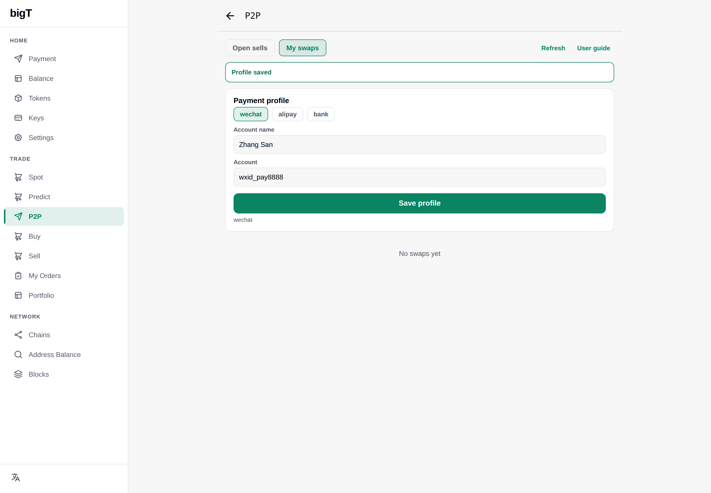

### Step 2 — Seller lists 10 BIG for 715 CNY on the wechat rail

**P2P → My swaps → List a sell order**: token `bc` (BIG's on-chain id), amount
`10`, price `71.5` CNY per BIG → **Total 715 CNY**, chain `L0`, payment method
**wechat**. The signed `POST /orders` payload carries no PII:

```json
{ "sellerDid": "did:key:z446G…(ML-DSA did, ≈3.5 kB)", "giveToken": "bc",
  "giveAmount": "10", "giveChain": "L0", "wantCurrency": "CNY",
  "wantAmount": "715", "wantRail": "wechat", "validUntil": 1791510000,
  "nonce": "…16+ chars…", "timestamp": 1791509100000,
  "signature": "…hex SignatureBundle over sha256(canonical JSON)…"}
```

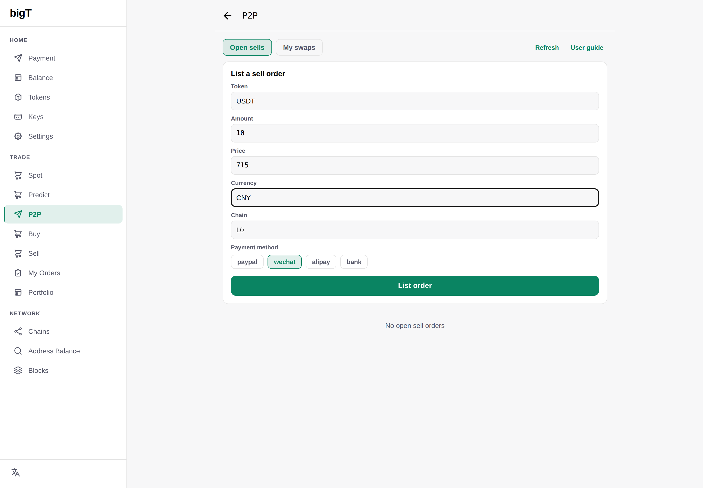

### Step 3 — Buyer matches the order

The buyer sees the order in the **Buy** tab and opens the buy panel. On a CNY
order the buyer provides the receive address for the tokens (their own wallet
address here) and must also have channel details for the chosen rail saved in
their own **My swaps** tab — the taker's details stay party-private and never
enter the book:

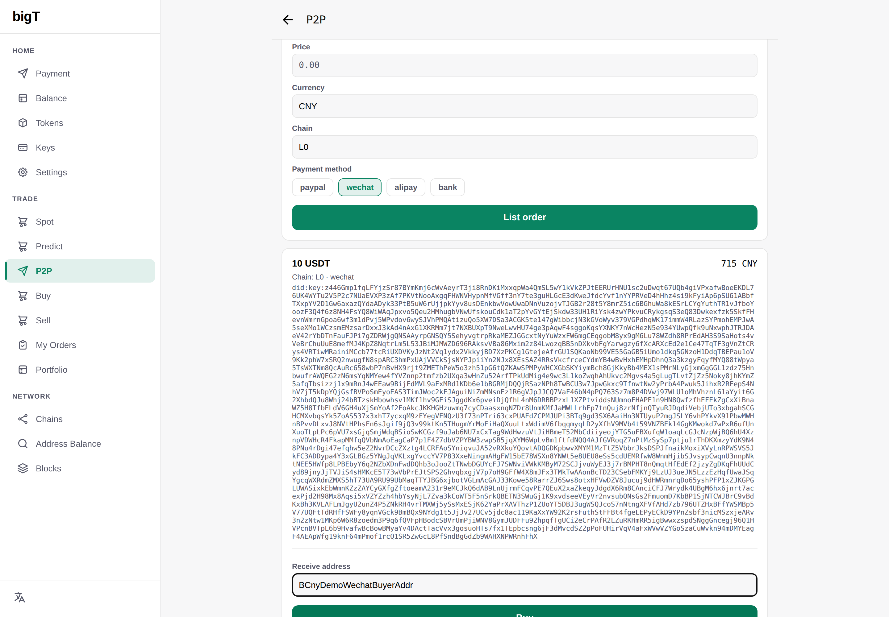

After **Confirm buy** the engine mints the swap at `MATCHED` and derives the
2-of-3 escrow address from the seller's and buyer's PQ dids plus the engine's
prefixed ML-DSA public key (`SETTLEMENT_ENGINE_PUBKEY`):

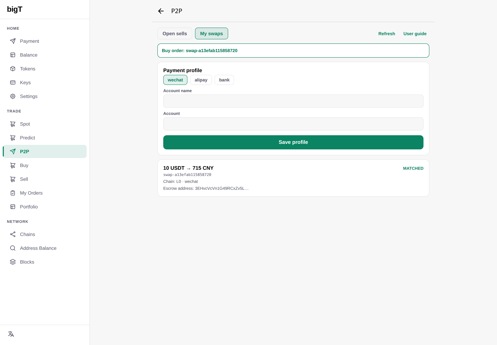

### Step 4 — Seller locks the token escrow

The seller's key pays the swap's 2-of-3 vault (the app shows the escrow
address on the swap card) — a real BIG transfer on L0. Back on the seller's
**My swaps** tab, the seller pastes that funding transaction hash and presses
**Lock escrow** — a seller-signed `action=escrow_lock` transition. The engine
re-reads the transaction on L0 and fails closed unless it is `CONFIRMED` at the
derived escrow address and holds the advertised amount:

```json
{ "txHash": "…64 hex…", "escrowAddress": "3PZ7gUE86SjcCkDDzYWcdXkHju3thAg5u2",
  "…": "CONFIRMED on https://eu1.bigtangle.org — proof, not a claim" }
```

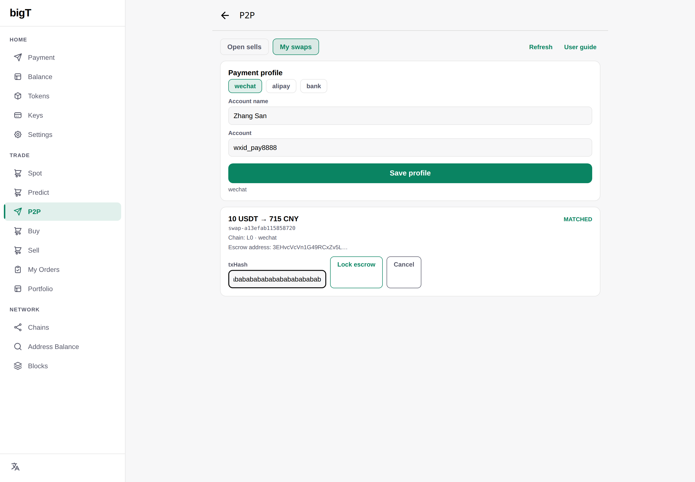

Status advances to `ESCROW_LOCKED`. **Nothing has been paid yet** — this is the
point of no return for the seller's tokens.

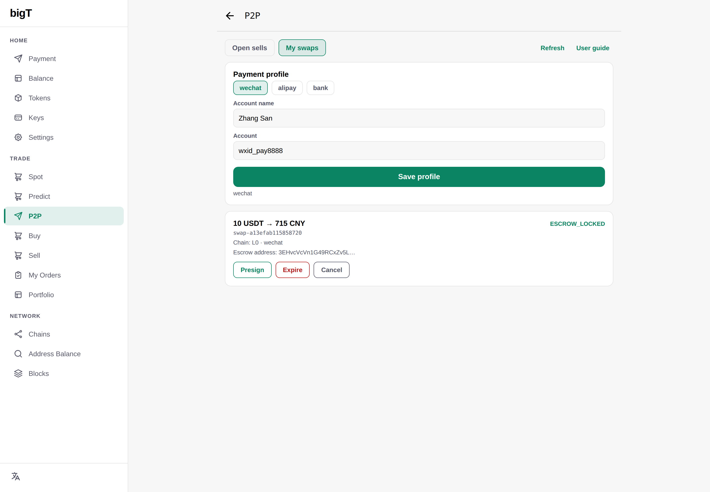

### Step 5 — Buyer pulls the signed payment instructions

The buyer's card now shows a **Payment details** button. Pressing it issues the
buyer-signed `POST /swaps/:id/payment-instructions`, which is idempotent while
`PAYMENT_PENDING` and reveals the seller's profile + a fresh per-swap `remark`
the transfer *must* carry:

```json
{ "method": "wechat", "rail": "wechat", "accountName": "Zhang San",
  "account": "wxid_pay8888", "amount": "715", "currency": "CNY",
  "remark": "f71ade2d23e9", "payBy": 1791510060 }
```

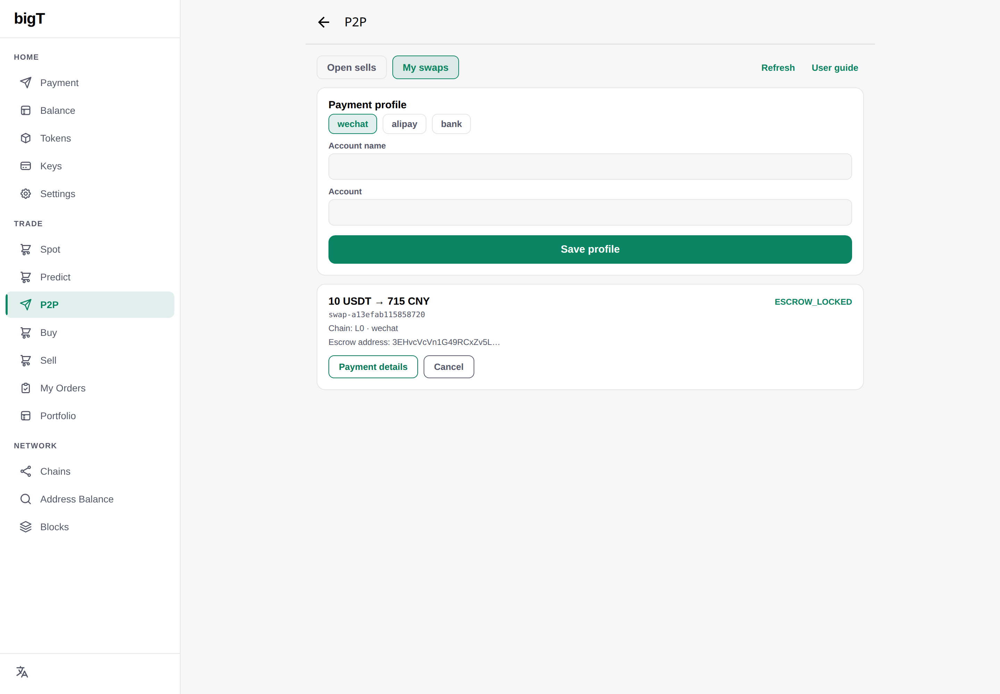

The instructions render **inline in the swap card** (amount, account, remark,
deadline) — plus an optional QR payload when the profile stores one:

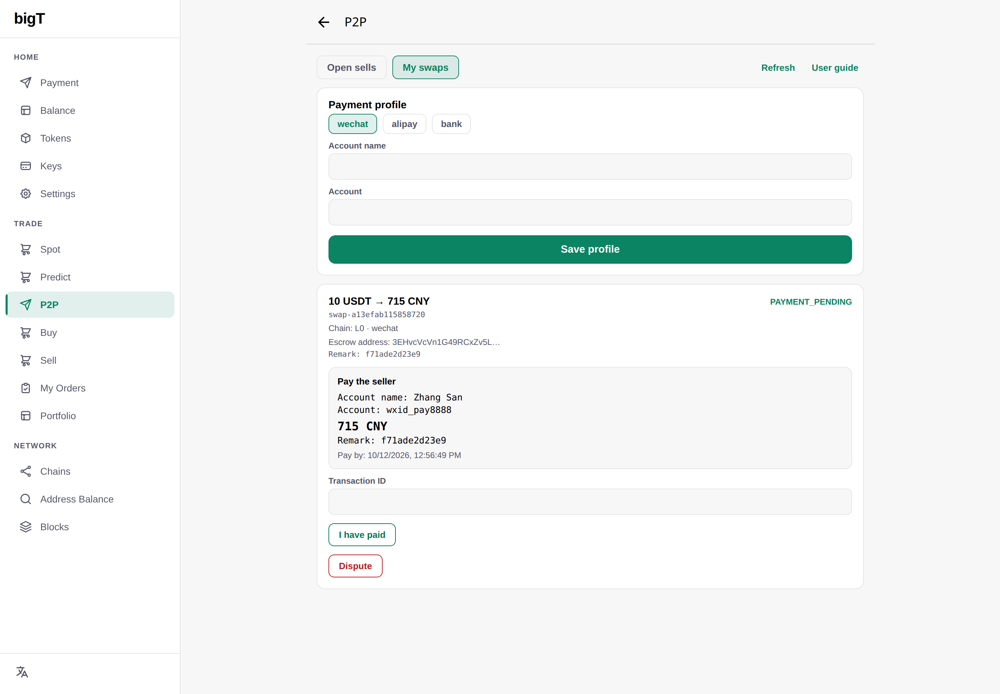

### Step 6 — Buyer pays in WeChat and claims with the transaction number

The buyer transfers `715 CNY` in their own WeChat app, pastes the transaction
number (starts `4203`) into **Transaction ID**, and presses **I have
paid** (`POST /swaps/:id/proof`). The optional receipt image is stored as-is in
the proof store; only its `sha256` is anchored on the swap event.

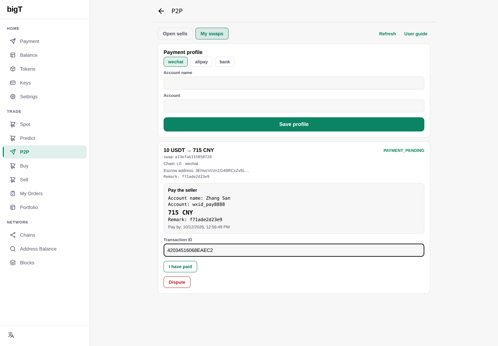

Status is now `PAYMENT_CLAIMED` — **the tokens are still locked.** This state
exists purely as the buyer's claim.

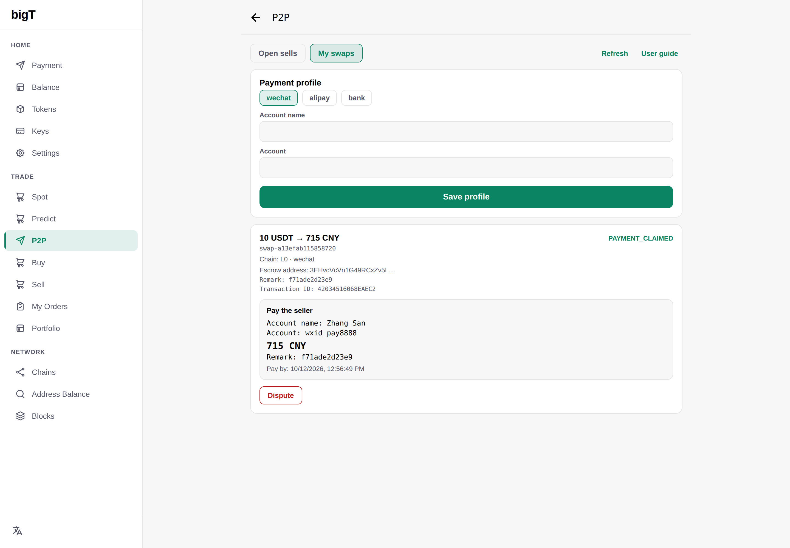

### Step 7 — Seller verifies on their own statement, then confirms

The seller's card shows the swap, the per-swap `remark` and the red confirmation warning. The seller checks
**amount + remark + time + transaction number in their own WeChat account** (screenshots
never count), and only then presses **Confirm received** — a seller-signed
`POST /swaps/:id/confirm`. The red warning above the button is the whole safety
story of the CNY rail:

> Confirm only after the money is visible in your own account — this releases
> the tokens immediately.

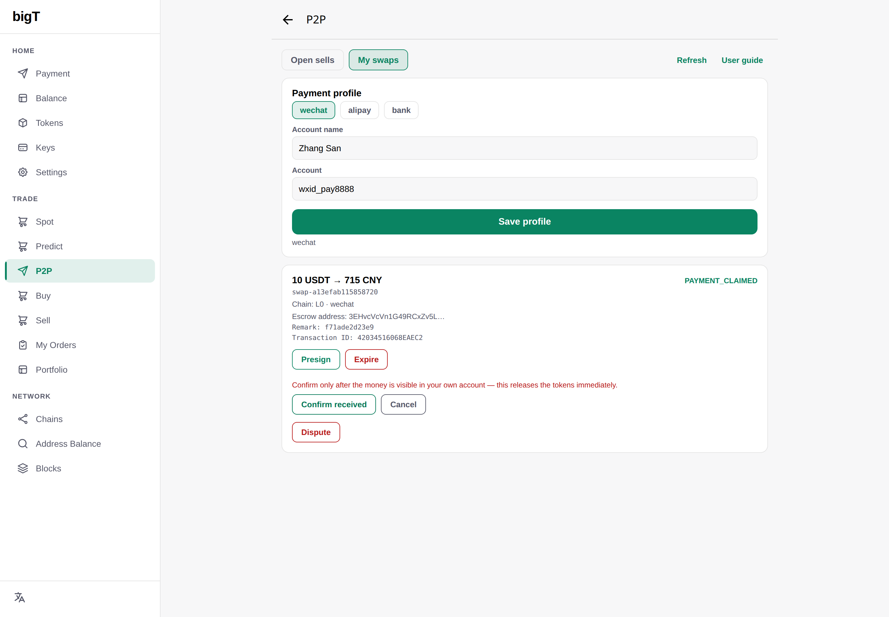

`PAYMENT_VERIFIED`:

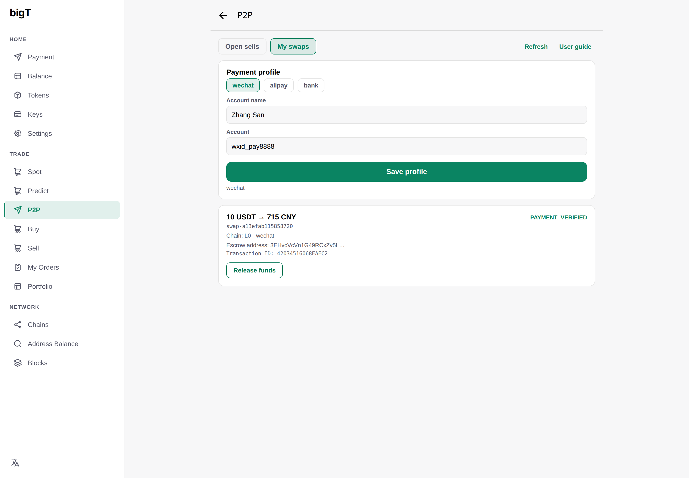

### Step 8 — The engine releases the escrow on chain

`release` and `complete` are engine-signed actions — the wallet deliberately
holds no key for them (§6.1). At lock time the seller's wallet **pre-signs**
both spend paths (the card shows *Escrow pre-signed*); the settlement hook
(`SETTLEMENT_ESCROW_HOOK_MS`) then adds the engine's signature to the release
spend, broadcasts it, waits for `CONFIRMED`, and only then moves the swap:

```bash
POST /swaps/swap-…/transitions   # engine-internal: action=release, txHash=…
→ { "status": "ESCROW_RELEASED" }   # also the on-chain release spend
POST /swaps/swap-…/transitions   # action=complete (CNY: no fiat payout)
→ { "status": "COMPLETED" }
```

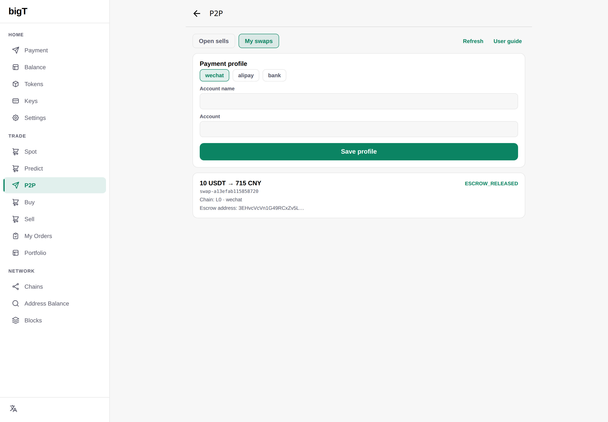

The swap then completes:

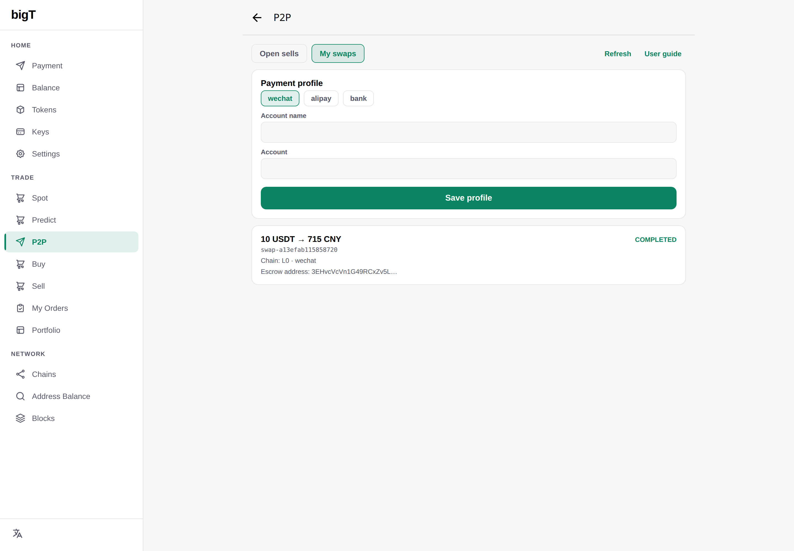

---

## 5. The same flow on production L0 (operator reference)

The demo above runs without money. The identical UI flow against production
lands real BIG, so the numbers below are from an **operator-only** capture
(`e2e/capture-p2p-prod.mjs`, requires `ALLOW_REAL_FUNDS=1`) — they are not the
hashes in the screenshots above.

| Item | Value |
|---|---|
| Wallet app | `https://wallet.bigt.ai` (live build, mainnet) |
| Swap | `swap-ddcfbb82ae02ff9c` — `10 bc → 715 CNY`, rail `wechat` |
| Seller / buyer | `1GPWeXtM7GkBhU8ayUH4bQ2eKKnB7aRcbz` / `16kZ4EaJ2iLMoW9sijFP1KNg8Z8NBjjR6A` |
| 2-of-3 vault | `38npQhSd8eriTQoqQkjFgdgJa26EH7kav7` |
| Escrow lock (L0) | `bfb5ee75362a3d838aff84d242324ca1772097143b72e363420d29fa9b62b9b8` — `CONFIRMED` |
| Per-swap remark | `5fa896011320` (the WeChat transfer must carry it) |
| Release (L0) | `5c9b53b9c32f5b2a189486bef5b9b1a4605b49882b1cc091e17813ed3825c3fe` — pays the buyer's address |
| Buyer's balance after | `9.999 bc` (10 BIG escrow less the L0 spend fee) |

What the production wiring adds over the demo harness:

1. **The escrow is money.** `payToScript` moves 10 BIG from the seller's key
   into the P2SH vault; `POST /swaps/:id/transitions action=escrow_lock` is
   refused unless the node reports the transaction `CONFIRMED`, paying the
   derived vault address, with the advertised amount (`verifyChainLock`).
2. **Every swap event is anchored** as a `social.p2p-swap` record on L1-SOCIAL.
   The production engine runs the no-database (blob) stack, so
   `SETTLEMENT_ANCHOR_MODE` is forced to `required`: if the anchor cannot land,
   the transition fails closed instead of leaving store state the chain does not
   have.
3. **The release is automatic.** At lock the seller's wallet pre-signs both
   spend skeletons (*Escrow pre-signed* on the card); after the seller confirms,
   the settlement hook (`SETTLEMENT_ESCROW_HOOK_MS=30000`) adds the engine's
   signature, broadcasts, waits for `CONFIRMED`, and moves the swap to
   `ESCROW_RELEASED`. Nobody signs a release by hand.

**One operational caveat, measured on this run.** L1-SOCIAL produces a block
about every 20 s and the engine's anchor key must spend a *confirmed* output per
record; its change is `spendPending` until the next block. Two swap events that
land inside the same block window therefore make the second anchor fail closed
with `insufficient spendable outputs for social tx` (the UI shows the error and
the retry succeeds ~40 s later). Funding the anchor key with a handful of
separate small UTXOs — or queueing anchors inside the engine — removes the
retry; until then a live flow needs a beat between anchored steps. The capture
script paces and retries automatically.

---

## 6. Device-side verification — the payee's own phone

A CNY transfer has no webhook, so the seller's own account is the receipt. The
wallet/engine can **read it automatically** through the on-phone agent
([`android-remote-control-mcp`](https://github.com/danielealbano/android-remote-control-mcp)),
so the seller does not have to eyeball the statement by hand. The user pairs the
phone once (endpoint + capability token, revocable); the pairing **is** the
consent.

Pairing is a **short single-use code** the app prints on its Server screen: the
user enters the endpoint and the code in the wallet's **Device** screen
(**Pair with code**) or dai's **Mobile** page, and the app hands back a
per-device token — no long bearer to copy (`POST /pair/claim`). Revoking the
device in the app (Settings › Access › Paired devices) kills its token
immediately.

Two reads satisfy the same `DeviceGateway`:

- **Screen read (accessibility).** Alipay and bank apps expose their UI tree;
  the worker reads the entry as text. WeChat **hides its window from
  accessibility**, so for WeChat use the notification read.
- **Receipt-notification read.** The payee's phone receives WeChat Pay's own
  “payment received” push; the worker reads the notification shade and parses
  amount / memo / transaction number / time from it. This works even though WeChat hides
  its UI.

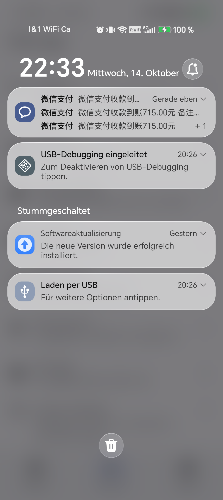

*Device capture. The notification text is illustrative — no real transfer was
made for this shot; on a live swap it carries the swap's own `remark` and
transaction number.*

The engine drives it (docs/p2p.md §12):

```
POST /pairings                       → register the endpoint (DID-signed grant)
POST /swaps/:id/device-read {via}    → engine reads the caller's own side
POST /swaps/:id/verify               → the wallet signs the verdict
```

`device-read` takes `via: "screen" | "notification"` and returns a verdict
(`observed: sent|received|none`) checked against the swap (exact amount, the
per-swap `remark`, the time window, the transaction number). Under
`SETTLEMENT_CNY_AUTO_RELEASE_ON` the engine may then act **without** the manual
*Confirm* tap:

| Policy | Machine confirmation |
|---|---|
| `off` (default) | verdicts are dispute evidence only |
| `seller_receipt` | the **seller's** own `received` read stands in for the confirm tap |
| `two_sided` | the buyer's `sent` **and** the seller's `received` must agree on one transaction number |
| `verified_receipt` | a bank e-receipt that passed the bank's public receipt verification settles it alone |

A **notification** seller read qualifies as `seller_receipt`. Trust is tiered:
one-sided evidence never machine-confirms under `two_sided`, and only the
**payee's own** device is the side that counts. This is locked by
`services/p2p-engine/test/wechat-mcp-verify.e2e.test.ts` — a mock `android_*`
MCP endpoint serves the WeChat screen **and** the payment received push, and the engine
runs the full read → verdict → `/verify` → machine-confirm to `PAYMENT_VERIFIED`.

---

## 7. HTTP API reference (CNY rails)

All mutating endpoints take a signed body:

```jsonc
{ /* endpoint-specific fields, e.g. action / txId / … */
  "did": "did:key:z446G…",         // ML-DSA-87 did:key — the signer (see table §1)
  "nonce": "b1f0…",                // ≥16 chars, single use
  "timestamp": 1791509100000,      // ms, ±5 min (sign.ts NONCE_MAX_SKEW_MS)
  "signature": "…hex SignatureBundle…" }
```

`signature` = **PQ**: `SHA256(JSON.stringify(payload, sortedKeys))` signed with
the did's ML-DSA-87 key, hex-serialized `SignatureBundle` (`sign.ts:39-61`,
mirrors the wallet's `p2pIdentity.signP2pPayload`). A classic did instead
verifies an Ed25519 signature over the raw bytes, or an ECDSA signature over
their sha256 — supported for compatibility, not what new keys use. `payload`
is always the body **without** `signature`.

| Endpoint | Signer | Required fields | Success |
|---|---|---|---|
| `GET /healthz` | — | — | `{ ok: true }` |
| `GET /public/orders` | — | — | `{ orders: […] }` (no signature, no PII) |
| `GET /capabilities` | — | — | `{ rails: […] }` (which rails this engine serves) |
| `POST /profiles` | seller | `method`, `accountName`, `account` (+`bankName`, `qr`) | `{ ok, method, updatedAt }` |
| `POST /profiles/mine` | seller | — | `{ profiles: […] }` |
| `POST /orders` | seller | `giveToken`, `giveAmount`, `giveChain`, `wantCurrency`, `wantAmount`, `wantRail`, `validUntil` | `201 { orderId, status }` |
| `POST /orders/:id/match` | buyer | `receiveAddress` | `201 { swapId, status, escrowAddress }` |
| `POST /swaps/mine` | party | — | `{ swaps: […] }` |
| `POST /swaps/:id/transitions` | seller (lock/expire/refund) · either (cancel) · **engine** (release/complete) | `action`, +`txHash` for lock/release | `{ swapId, status }` |
| `POST /swaps/:id/payment-instructions` | buyer | — | `201 { …instructions, remark, payBy }` |
| `POST /swaps/:id/proof` | buyer | `txId` (1..64 `[A-Za-z0-9._-]`), optional `remark`, `receipt`, `receiptSha256` | `{ swapId, status, txId, receiptSha256 }` |
| `POST /swaps/:id/confirm` | seller | — | `{ swapId, status: "PAYMENT_VERIFIED" }` |
| `POST /swaps/:id/dispute` | either party | optional `reason` (≤512) | `{ swapId, dispute }` |
| `POST /swaps/:id/dispute/resolve` | admin token | `outcome=release\|refund` | `{ swapId, … }` |

Guard rails the engine enforces on every one of them:

* `409` when the status transition is illegal (`state.ts` `VALID_TRANSITIONS`),
  `409` on a dedicated action sent to the generic route (`instructions`,
  `payment_proof`, `payment_confirm` are rejected there),
* `403` unless `did` is the required signer, `400` on bad signature, replayed
  nonce, stale timestamp, or `rate limit exceeded` (10/min/DID),
* `422 swap frozen: …` while a dispute is open for the forward actions,
* `400` for rail/action mismatches.

---

## 8. Review findings (code review of the CNY implementation)

Verified good: the transition table keeps `PAYMENT_CLAIMED` out of the release
path; `release`/`complete` are engine-only; the profile is party-scoped; the
remark is regenerated per swap and checked on `proof`; the receipt hash is
recomputed server-side; unit tests cover the CNY legs
(`services/p2p-engine/test/cny.test.ts`).

Open gaps, in the order they matter:

1. **The anchor key is a single sequential spender.** Each swap event anchors
   on L1-SOCIAL through `submitSocialRecord`, which spends one confirmed UTXO
   and leaves the change `spendPending` until the next block (~20 s). A burst of
   events therefore fails closed with `insufficient spendable outputs for
   social tx`. Keep several anchor UTXOs funded (or queue/retry inside the
   engine) so a normal settlement — match, lock, instructions, claim, confirm,
   release, complete — never waits on a block window.
2. **`payBy` is advisory.** The `SETTLEMENT_CNY_REMARK_TTL` deadline is returned
   to the buyer but never enforced — a swap can be claimed after it expires,
   and `SETTLEMENT_CNY_MAX_CENTS` / a confirm timeout are not implemented.
3. **`receiptSha256` hashed the data-URL string, not the image bytes** — fixed:
   `server.ts` decodes the `data:image/…;base64,…` payload and hashes the
   decoded bytes (400 on malformed base64), so the digest is reproducible with
   `sha256 <file>`; `test/cny.test.ts` asserts it.
4. **`Alert.alert` is a no-op on react-native-web** — every error/success
   message in the P2P screen (including the payment instructions) was invisible
   in the web build. Fixed: inline notice banner + inline instructions panel +
   confirm warning, localized in 12 languages (`p2p.payBy`, `p2p.confirmWarn`).
5. **Rate limit bites scripted flows.** 10 signed calls/DID/minute is tight for
   the wallet's own read-modify loops (`/swaps/mine` after every transition);
   the capture script has to pace itself. Worth making `RATE_LIMIT` an env knob
   if real users ever hit it.

---

## 9. Regenerating this guide

```bash
# 1. screenshots — funds-free local engine (synthetic hashes, nothing moves)
./p2pdemo.sh capture walkthrough

# 2. PDFs (gitignored build artifacts)
node docs/p2p-demo/scripts/gen-p2p-all-pdf.mjs   # → assets/p2p-all.pdf
npx tsx scripts/docs-pdf.mts p2p                 # 12-language help guides

# 3. publish to the public bucket the app links to
scripts/publishpdf.sh                            # apps/wallet/docs/demo on s3.bigt.ai
```

`publishpdf.sh` writes to the EU write primary and then HEADs every read site
(us 302-redirects to the primary, asia serves a GEO replica), comparing each
object's byte size with the local file. A production-escrow capture
(`e2e/capture-p2p-prod.mjs`) is operator-only and needs `ALLOW_REAL_FUNDS=1`.

The offline harness (`./p2pdemo.sh capture walkthrough`, memory engine, no
chain) still renders the same shots with synthetic hashes. The generator is
dependency-free (own markdown → HTML, images embedded as data URIs,
`chromium --headless --print-to-pdf`), the same pipeline the dai help guides
use.
