# FIAT (fiat currency) settlement — exchange BIG with WeChat / Alipay / bank transfer or PayPal

**Terms.** FIAT = fiat currency; CNY = Chinese yuan; USD = US dollar; P2P = peer-to-peer.

**What this is.** In the Bigtangle wallet you exchange **BIG** directly for fiat currency (WeChat Pay / Alipay / bank transfer, or **PayPal USD**). The seller's BIG goes into an **escrow address** first, and moving those funds requires the agreement of two out of three parties: seller, buyer and platform. The buyer pays the seller directly. The seller confirms the payment on their own statement and then releases the BIG. The platform never holds your funds and never touches the fiat currency.

**About the screenshots.** The screenshots below come from a real-device demo environment; amounts and hashes are demo data and no real funds are involved.

This guide walks through: a seller posting BIG for sale, a buyer purchasing, the escrow locking, the buyer paying, the seller confirming, the BIG being released, and the timeout refund path. The rate is **BIG/CNY = 0.01**, and the order is **10,000 BIG → 100 CNY**.

## Flow at a glance

```
Pending match → Matched → Escrow locked → Awaiting payment → Payment claimed → Payment confirmed → Escrow released → Completed
```

Every step shows on the trade card in the app; the status only moves forward, never skipping or going back.

Optional path: if the two sides disagree after payment, either one can freeze the trade and open a dispute, and the platform helps decide the outcome (release the coins to the buyer or refund the seller).


**PayPal (USD).** When you choose **PayPal**, the fiat currency switches to **USD** automatically, the receiving account becomes a PayPal email, and the rest of the flow is identical. Full walkthrough: [p2p-paypal.zh.md](p2p-paypal.zh.md) → `assets/p2p-paypal.zh.mobile.pdf` (**10,000 BIG → 100 USD**).


---

## 1. The seller saves a receiving profile

The seller opens **P2P → My trades**, picks a receiving method (WeChat, Alipay, bank or PayPal) and fills in the account name and number (an email for PayPal). This information is shown only to the buyer after a trade is struck; it never appears in the public order book.

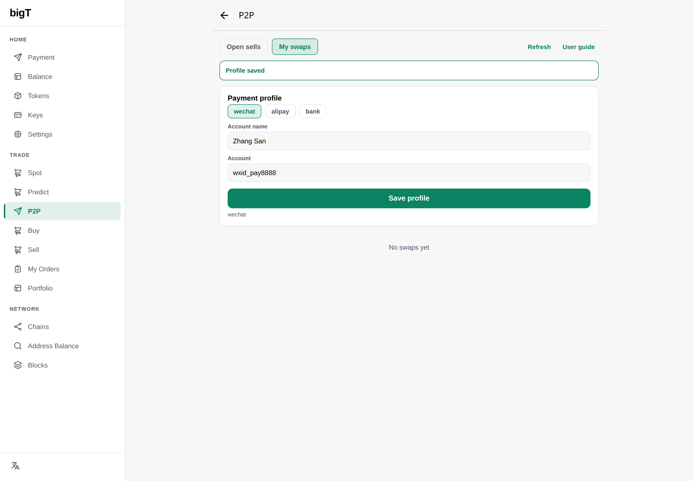

---

## 2. The seller posts BIG for sale

In **Post a sell order** the seller enters the token (`bc`), the amount **10,000**, the price **0.01**, the fiat currency **CNY** and the receiving method **WeChat**, then posts it.

Once posted, the sell order appears in the public order book with the status **Pending match**. The seller can cancel a trade that has not been matched at any time.

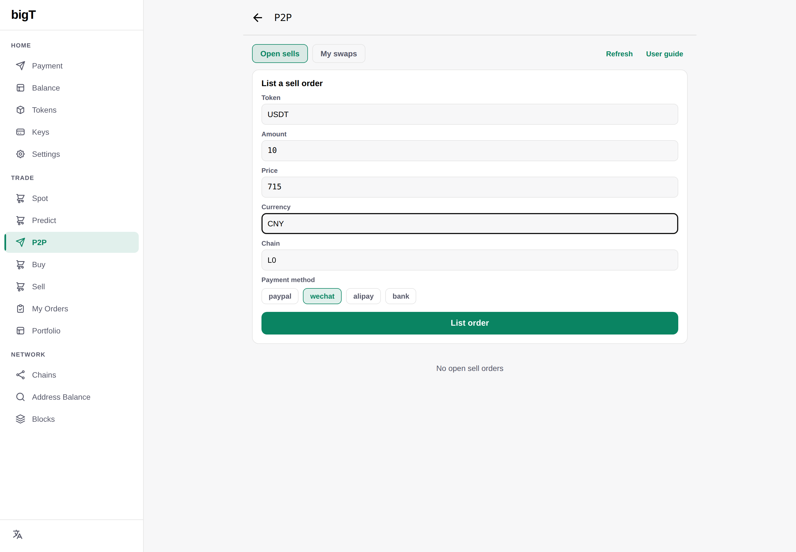

---

## 3. The buyer matches the order

The buyer opens the sell order, enters the address that should receive the BIG, and confirms the purchase. No WeChat or Alipay account is needed at this point — the seller's receiving details are shown separately to this buyer once the escrow is locked.

The app creates a unique trade number for this trade and prepares the escrow address; the status becomes **Matched**.

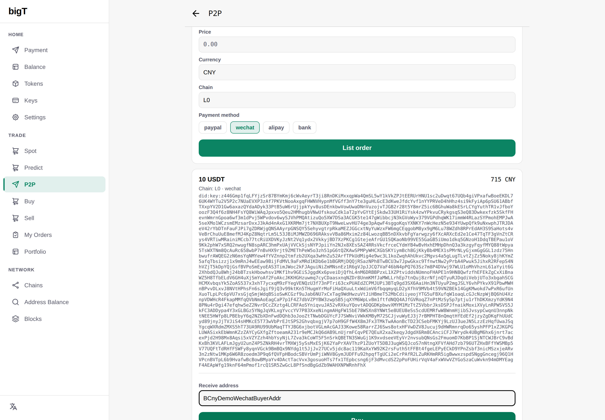

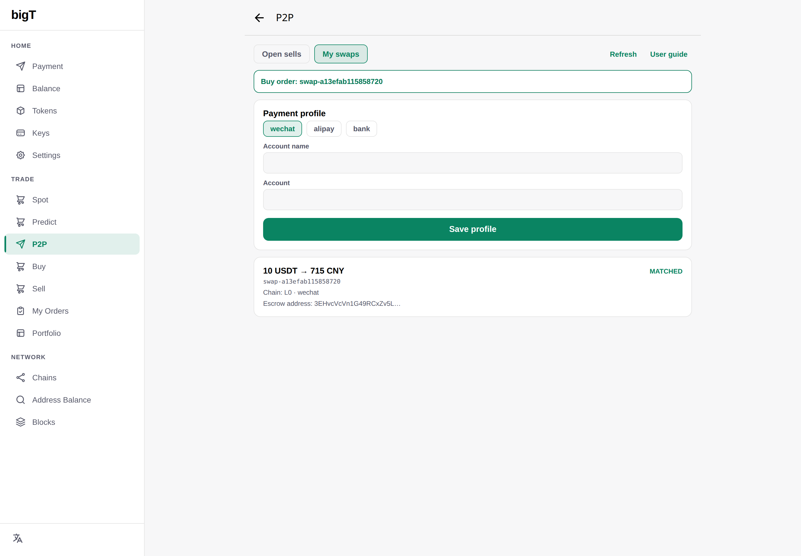

---

## 4. The seller locks the BIG into escrow

The app generates a **2-of-3 escrow address** for this trade: any two of the three parties — seller, buyer and platform — must agree before funds can move, so no single party can take the money alone.

The seller sends **10,000 BIG** to that address and pastes the transaction hash of that transfer into the app. Once the app has checked the amount and the receiving address, the status becomes **Escrow locked**. The buyer can see that the BIG is locked before paying any fiat currency.

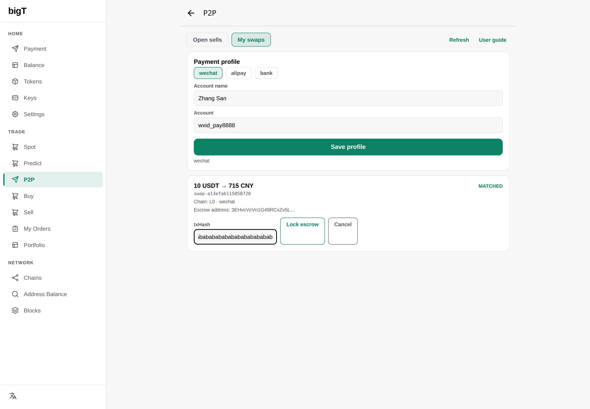

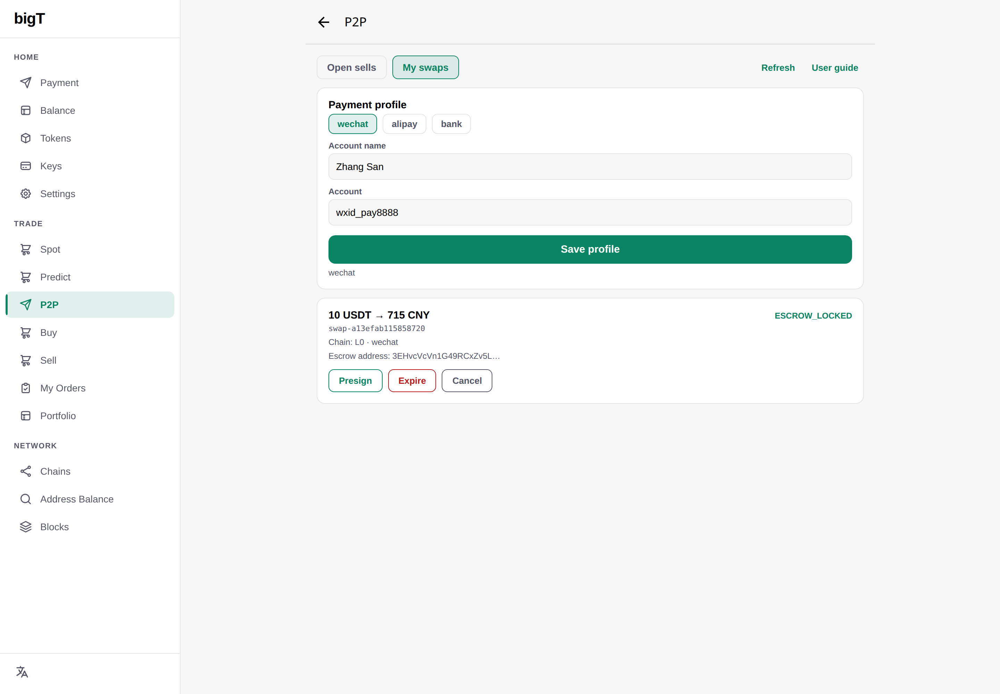

---

## 5. The buyer pulls up the payment instructions

When the buyer taps **Payment details**, they see:

- the seller's account name
- the receiving account (WeChat / Alipay / bank account number, or PayPal email)
- the exact amount, **100 CNY**
- a **reference code** unique to this trade
- the payment deadline

The buyer must put the reference code in the payment note when transferring. The status becomes **Awaiting payment**; if the buyer has still not paid by the deadline, the trade expires and is refunded.

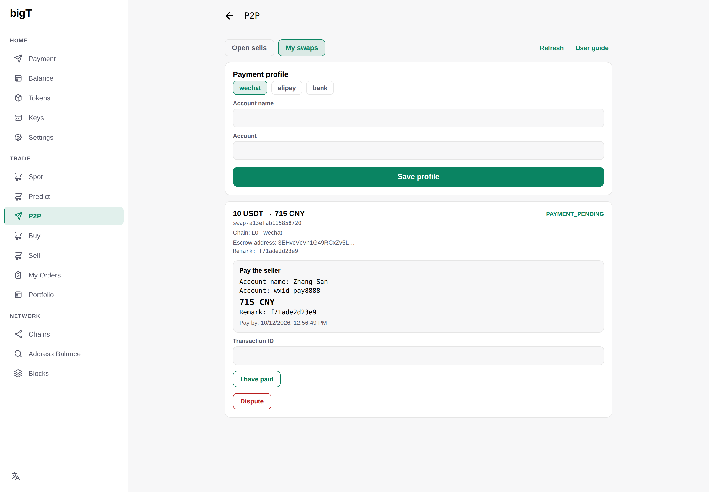

---

## 6. The buyer pays CNY and claims the payment

The buyer transfers **100 CNY** in their own WeChat, puts the reference code in the note, then pastes the transaction number (serial number) into **Transaction ID** and taps **I have paid**.

A payment receipt image can be attached; the image is stored on the server only and is never written on chain.

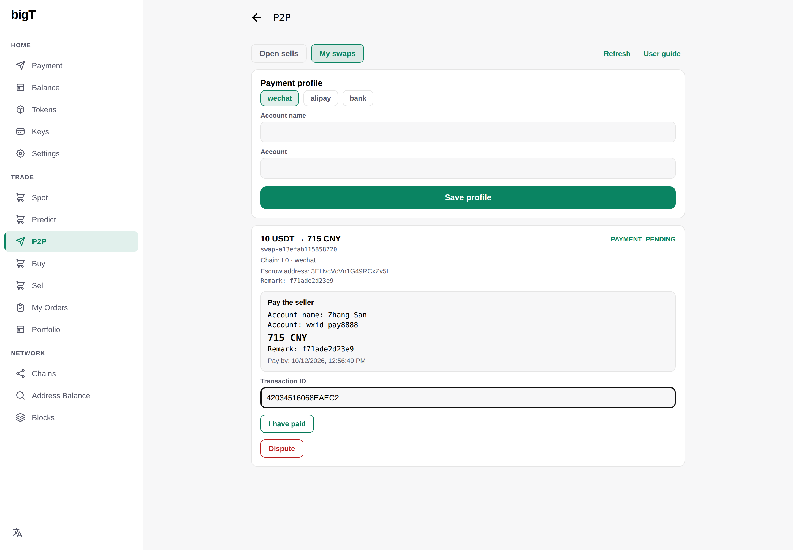

The status becomes **Payment claimed**. The BIG is still locked at this point — this is only the buyer's claim of payment.

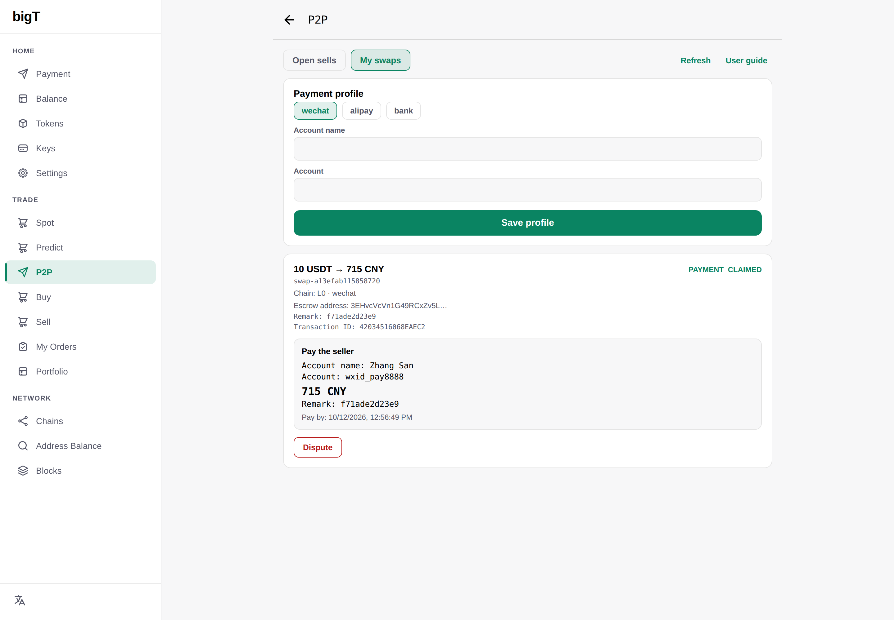

---

## 7. The seller confirms on their own statement

The seller's trade card shows the serial number and note the buyer entered. The seller checks **amount + note + time + serial number** against their own WeChat statement only, and taps **Confirm payment received** once everything matches.

A screenshot is not proof of payment; what actually arrived in your own account is what counts.

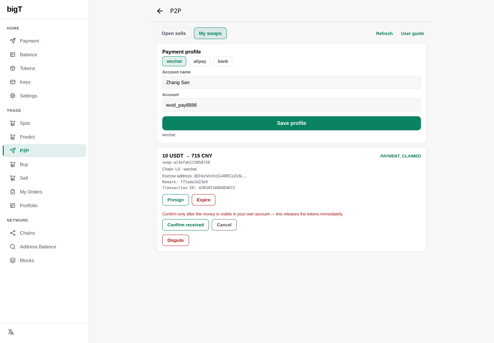

The status becomes **Payment confirmed**.

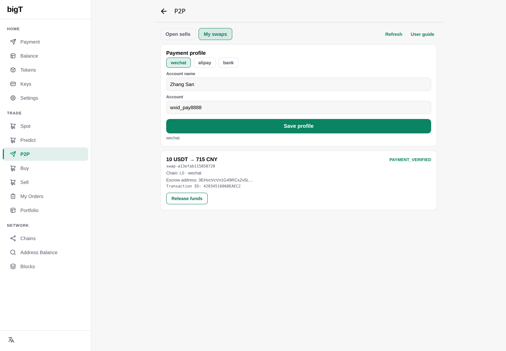

---

## 8. The seller releases the escrow

> **Sellers should release the escrow promptly.** After confirming the payment, tap **Release funds** right away. Delaying release lowers the seller's rating; serious or repeated delays mark the seller as **unsafe** and affect future orders.

The seller taps **Release funds** immediately after confirming the payment, the platform co-signs, and the BIG is transferred to the buyer's receiving address. The seller's signature plus the platform's signature are enough to complete the release, and neither party can move the money alone.

Because the seller was paid directly, there is no extra fiat payout step and the trade ends right away.

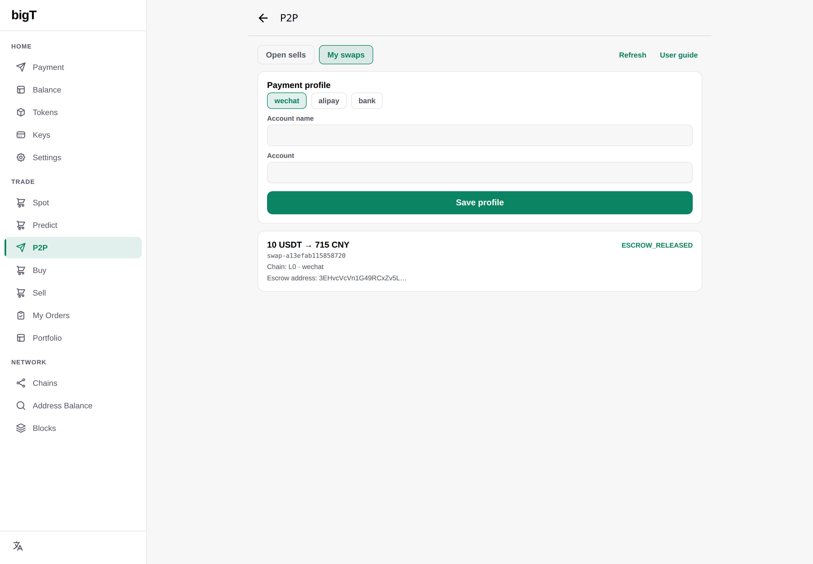

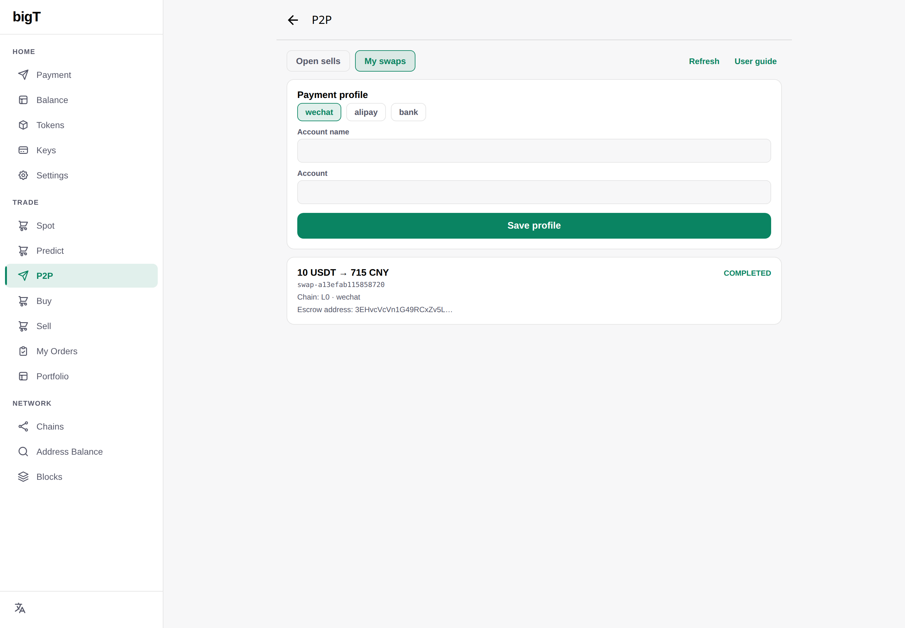

The status becomes **Completed**.

---

## 9. Optional: the platform helps decide a dispute

If the two sides disagree about the payment (wrong amount, money not received, a seller who will not release, and so on), either one can freeze the trade and open a dispute. The platform checks the escrow and the payment evidence and decides to **release the coins to the buyer** or **refund the seller**.

A seller's lost disputes and repeated delays are recorded in their reputation, and in serious cases they are marked **unsafe**.

---

## 10. Timeout or failure → refund

If the buyer never pays, the seller can let the trade expire; the escrowed BIG goes back to the seller without needing the buyer's agreement.

Neither side ever holds the other side's funds.

---

## 11. Optional: "Verify with my phone" (buyer, delayed release)

This is not required for normal settlement. The buyer only sees **"Verify with my phone"** when the seller is late to release (more than **30 minutes** after the buyer claims payment, or the payment is confirmed but the release keeps stalling) **or** a dispute is already open.

It is shown only for **Alipay / bank**, because on the buyer's side the transfer records can be read; WeChat only notifies the receiving party and PayPal has no read bridge, so neither shows it. The buyer reads the records once with their own paired phone, the wallet signs the result and submits it; the check is recorded in the seller's reputation, but it does not replace the release the seller should carry out promptly.

---

## Comparison: Binance P2P vs this settlement

| Feature | Binance P2P | This settlement |
|---|---|---|
| Fiat verification | Seller taps "confirm" (reputation system) | Seller confirms on their own statement, platform releases per the process |
| Fiat custody | Platform (buyer → seller) | Buyer pays the seller directly, platform never touches the fiat |
| Escrow | Platform internal ledger | On-chain 2-of-3 escrow, publicly auditable |
| Refund | Support ticket | Expired trades return to the seller automatically |
| Dispute resolution | Manual support (several days) | In-app dispute + platform ruling (faster) |

---

## Timeline

```
Matched               14:20  amount fixed at matching
Escrow locked         14:23  seller transfers BIG, app confirms receipt
Awaiting payment      14:24  buyer sees the payment instructions
Payment claimed       14:25  buyer pays and enters the serial number
Payment confirmed     14:26  seller confirms on their own statement
Escrow released       14:27  seller and platform co-sign, BIG goes to the buyer
Completed             14:27  trade ends
```

---

For implementation details on the state machine, signatures, escrow script and interfaces, see the developer document `docs/p2p.md`.
